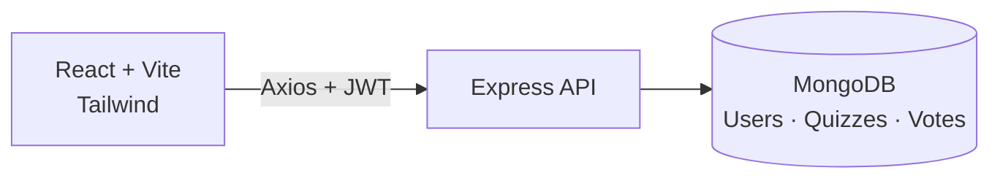

<div align="center">

# 🧠 QuizVote: Quiz & Polling App

**A full-stack MERN quiz platform. Admins create questions, users answer, and everyone competes on a live leaderboard.**


### [🌐 Live demo](https://qz-seven.vercel.app)

</div>

---

## ✨ Features

**For users**
- Register and log in (JWT auth, bcrypt-hashed passwords)
- Answer multiple-choice questions, **one answer per quiz** (enforced by a unique DB index)
- See whether you were right, plus **per-quiz results** with option-wise counts
- **Personal dashboard** with stats and a history of your answers
- **Leaderboard** ranking users by correct answers

**For admins**
- Create, edit and delete quiz questions with options and the correct answer
- View every vote on a quiz, including who picked a specific option
- A seed script creates the first admin account

**Engineering**
- Centralised error-handling middleware and `/health` endpoint
- Role-based route protection (`user` / `admin`)
- Vite + Tailwind frontend deployed on Vercel, with SPA rewrites

## 🏗️ Architecture



## 📡 API overview

| Area | Endpoints |
|---|---|
| Auth | `POST /api/auth/register` · `POST /api/auth/login` · `GET /api/auth/me` |
| Quizzes | `GET /api/quizzes` · `GET /api/quizzes/:id` · `POST` · `PUT /:id` · `DELETE /:id` *(admin)* |
| Votes | `POST /api/votes` · `GET /api/votes/:quizId/results` · `GET /api/votes/me/stats` · `GET /api/votes/me/votes` · `GET /api/votes/leaderboard` |
| Admin | `GET /api/admin/quizzes` · `GET /api/votes/admin/quiz/:quizId/votes` |

## 🗃️ Data model

| Collection | Key fields |
|---|---|
| `User` | name, email, password (hashed), role (`user` / `admin`) |
| `Quiz` | question, options[], correctAnswer (index), createdBy |
| `Vote` | quiz, user, chosenOption, isCorrect. Unique on `(quiz, user)` |

## 🚀 Run locally

```bash
git clone https://github.com/mayurvij22/QZ.git
cd QZ
```

**Backend** (`quiz-backend/.env`):

```env
PORT=5000
MONGO_URI=mongodb+srv://<user>:<password>@<cluster>/quizdb
JWT_SECRET=a-long-random-string
SEED_ADMIN_EMAIL=admin@example.com
SEED_ADMIN_PASS=change-me
```

```bash
cd quiz-backend
npm install
node scripts/seedAdmin.js   # create the first admin
npm run dev
```

**Frontend** (`quiz-frontend/.env`):

```env
VITE_API_URL=http://localhost:5000
```

```bash
cd ../quiz-frontend
npm install
npm run dev      # http://localhost:5173
```

## 🛠️ Tech stack

| Layer | Technology |
|---|---|
| Frontend | React, Vite, React Router, Tailwind CSS, Axios |
| Backend | Node.js, Express, Mongoose, JWT, bcrypt |
| Database | MongoDB |
| Hosting | Vercel (frontend) |

---

<div align="center">

Made by **[Mayur Patil](https://github.com/mayurvij22)**

</div>
